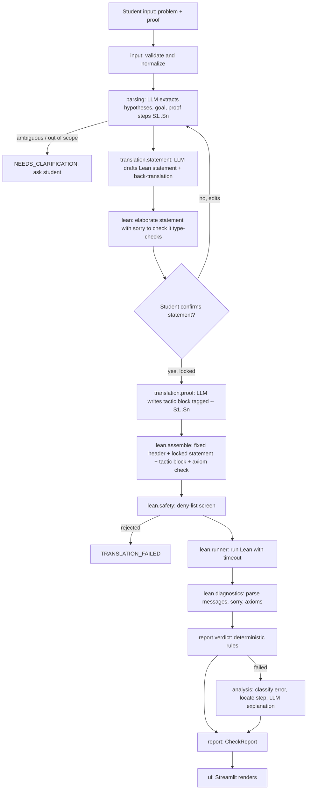

# Architecture

Status: **proposal (Milestone B0)**. Nothing below is implemented yet; each
section names the milestone in [DEVELOPMENT_PLAN.md](DEVELOPMENT_PLAN.md) that
builds it. Requirements: [SPEC_BASIC.md](SPEC_BASIC.md),
[SPEC_ADVANCED.md](SPEC_ADVANCED.md).

## 1. Non-negotiable rules

These come straight from the specs and shape every module:

1. **Lean decides, the LLM never does.** The verdict is computed by Python code
   from Lean's process result and diagnostics. No LLM output can produce or
   upgrade a `VERIFIED` status.
2. **A compiled Lean proof is not a verdict on the student's proof.** The report
   always separates *"Lean accepted the formalized proof"* from *"the
   formalization faithfully reflects what the student wrote"*. The UI never says
   "your proof is correct".
3. **The statement is locked before the proof is translated.** The student sees
   the original statement and the Lean statement side by side and confirms it.
   After that, Python — not the LLM — assembles the final Lean file around the
   confirmed statement, so the translator cannot weaken the theorem to make a
   proof go through.
4. **Ambiguity stops the pipeline.** If the parser reports ambiguity or an
   out-of-scope problem, the app asks the student instead of inventing
   assumptions.
5. **Lean runs in a controlled way.** The LLM never writes imports, commands, or
   shell input. Generated Lean is screened by a deny-list, run with a timeout
   from a temporary directory, with an argument list (never `shell=True`).

## 2. Pipeline



Every LLM step is a **separate, small call with a structured (Pydantic) output
schema**. No step asks the model for one large unstructured answer.

## 3. Verdict rules (deterministic)

| Status | Condition |
| --- | --- |
| `VERIFIED` | Lean exited normally within the timeout **and** there are no `error` diagnostics **and** no `sorry` warning **and** `#print axioms` reports only `propext`, `Classical.choice`, `Quot.sound` **and** the compiled theorem statement is byte-identical to the student-confirmed one. |
| `VERIFICATION_FAILED` | Lean ran to completion and reported an error, an unsolved goal, or a non-standard axiom. |
| `TRANSLATION_FAILED` | The LLM output was invalid, refused, incomplete (a step it could not formalize is left as an explicit placeholder), or rejected by the safety screen. |
| `NEEDS_CLARIFICATION` | The parser found ambiguity, or the problem is outside the supported topics. |
| `RUNTIME_ERROR` | Lean is missing, crashed or timed out, or the LLM API call failed. |

Alongside the status, every report carries a **fidelity summary** that is never
folded into the status:

* whether the student confirmed the formal statement;
* proof steps that were translated as written, **added** by the translator,
  **omitted**, or **changed** (computed from the `-- [Sk]` step tags, see §6);
* translator notes.

Headline wording follows both: e.g. *"Lean accepted the formalized proof. The
translator added 2 steps that are not in your proof — see the mapping."*

## 4. Modules

Python package `src/ra_checker/`. One responsibility per module; the UI holds no
business logic; every external dependency (LLM, Lean) sits behind a small
interface with a fake for tests.

| Module | Responsibility | Spec component | Milestone |
| --- | --- | --- | --- |
| `config.py` | Settings from environment / `.env` (API key, model, Lean path, timeouts). | infrastructure | B1 |
| `models.py` | Pydantic data models shared by all modules (see §5). | infrastructure | B1 |
| `logging_setup.py` | Standard-library logging; never logs keys; logs IDs and statuses, not full student text, by default. | infrastructure | B1 |
| `input/` | Length limits, Unicode normalization, empty-input checks. | input processing | B4 |
| `llm/client.py` | `LLMClient` protocol, `AnthropicClient` (official `anthropic` SDK, structured outputs), `FakeLLMClient` for tests. | LLM communication | B4 |
| `llm/prompts/` | Versioned prompt templates; the prompt version is recorded in each report. | LLM communication | B4 |
| `parsing/problem_parser.py` | Hypotheses, goal, numbered proof steps, ambiguities, topic/scope check. | problem parsing | B4 |
| `translation/statement.py` | Lean statement + natural-language back-translation + list of any assumptions added. | Lean code generation | B5 |
| `translation/proof.py` | Tactic block only, each block tagged `-- [Sk]`; step map; translator notes. | Lean code generation | B5 |
| `lean/assemble.py` | Builds the `.lean` file: fixed header, locked statement, tactic block, `#print axioms`. Records line offsets. | Lean execution | B2 |
| `lean/safety.py` | Deny-list screen of generated Lean (§7). | Lean execution | B2 |
| `lean/runner.py` | `LeanRunner` protocol; subprocess runner with timeout and process-tree kill; `FakeLeanRunner`. | Lean execution | B2 |
| `lean/diagnostics.py` | Parses Lean output into `Diagnostic` objects; detects `sorry` and axioms. | Lean execution | B2 |
| `analysis/classify.py` | Rule-based Lean error kind from the message text. | error analysis | B6 |
| `analysis/locate.py` | Maps a diagnostic line to the enclosing `-- [Sk]` tag and the student's step text. | error analysis | B6 |
| `analysis/explain.py` | LLM explanation with category, origin, confidence, correction direction (§8). | error analysis | B6 |
| `report/verdict.py` | The deterministic verdict rules of §3 and the fidelity summary. | result presentation | B2/B7 |
| `pipeline.py` | Orchestrates the steps; two phases (formalize statement, then verify proof). | orchestration | B7 |
| `ui/app.py`, `ui/components.py` | Streamlit pages and rendering only. | user interface | B7 |
| `explain/code_explainer.py` | Per-block code explanation grounded in the actual code and verdict. | code explanation | A2 |
| `explain/proof_mapping.py` | Original-step ↔ Lean-block table with added/omitted/changed flags. | proof mapping | A3 |
| `analysis/correction.py` | Proposes corrected code, **re-runs it through Lean**, labels it verified only if §3 passes. | enhanced errors | A4 |
| `learning/glossary.py`, `learning/content/` | Curated, Lean-checked concept cards (intro, rw, …) selected by tactics found in the code. | learning content | A5 |
| `learning/practice.py` | Short exercises whose answers are checked by the real Lean runner. | learning content | A5 |

## 5. Core data models (implemented in B1)

`src/ra_checker/models.py`. All models are frozen Pydantic models with tuple
collections and `extra="forbid"`; student text is stored verbatim.

* `Submission` — `problem_text`, `proof_text`, `mode` (`quick` / `learning`).
* `ProblemAnalysis` — `hypotheses`, `goal`, `proof_steps` (`ProofStep`: `id`
  `S1…`, `text`), `ambiguities`, `in_scope`, `topic`; `needs_clarification`.
* `FormalStatement` — `lean_statement`, `back_translation`,
  `assumptions_added`, `confirmed_by_student`.
* `ProofTranslation` — `tactic_block`, `step_map` (`StepMapping`: `step_id`,
  `status` `translated` / `added` / `omitted` / `changed`, `note`),
  `translator_notes`. Student steps use ids `S1, S2, …`; steps the translator
  adds use `A1, A2, …` and must have status `added`.
* `FidelitySummary` — `statement_confirmed` and the step ids per status;
  `from_translation()`; `is_faithful`.
* `LeanRun` — `source` (the exact file Lean checked), `exit_code`,
  `timed_out`, `duration_s`, `stdout`, `stderr`, `lean_version`.
* `Diagnostic` — `line`, `column`, `severity`, `message`, `goal_state`,
  `step_id`.
* `ErrorAnalysis` — `lean_error_kind`, `category` (the spec categories, with
  missing assumption and incomplete proof kept separate, plus
  `formalization_error` and `unknown`), `origin`, `confidence`, `raw_message`,
  `explanation`, `step_id`, `line`, `correction_direction`.
* `CheckReport` — `id`, `created_at` (UTC), `submission`, `status`,
  `status_detail`, all stage outputs above, `llm_model`, `prompt_version`.

`CheckReport` validates its status on construction and on deserialization:
`VERIFIED` needs a completed Lean run with exit code 0, no error diagnostics,
no error analyses, a student-confirmed statement that appears in the checked
source, a proof translation and a fidelity summary; `VERIFICATION_FAILED` needs
the Lean run; `NEEDS_CLARIFICATION` needs an ambiguous or out-of-scope
analysis; every non-verified status needs a `status_detail`. This is a last
line of defence; §3's full rules live in `report/verdict.py`.

Settings (`config.py`) and logging (`logging_setup.py`) are described in the
README's Configuration section.

## 6. Lean layer

**Project.** A Lake project in `lean/` with `lean-toolchain` and the Mathlib
dependency pinned to one release (chosen at B2). Mathlib build artefacts come
from `lake exe cache get`; `lean/.lake/` is git-ignored.

**Student-friendly definitions** (B3). Students write ε–N proofs; Mathlib states
limits with filters (`Tendsto u atTop (𝓝 L)`). Translating ε–N reasoning
directly into filter language would make the proof mapping unfaithful. So
`lean/RaChecker/Defs.lean` defines the textbook notions, for example

```lean
def SeqConvergesTo (a : ℕ → ℝ) (L : ℝ) : Prop :=
  ∀ ε > 0, ∃ N : ℕ, ∀ n ≥ N, |a n - L| < ε
```

and each definition is paired with a proven bridge lemma to Mathlib
(`seqConvergesTo_iff_tendsto`), so the definitions are checked to mean what
Mathlib means. The translator is instructed to use these definitions.

**Assembled file.** The LLM writes only the tactic block. Python writes
everything else:

```lean
import Mathlib
import RaChecker.Defs
open RaChecker

theorem student_claim <locked statement> := by
  -- [S1]
  intro ε hε
  -- [S2]
  ...

#print axioms student_claim
```

Before the proof is translated, the locked statement is elaborated once with
`:= by sorry` to prove it type-checks.

**Execution.** Each check writes the file to a fresh temporary directory and
runs Lean through `lake env lean <file>` (with the Lean project as working
directory), using an argument list, a wall-clock timeout, an output-size cap,
and process-tree termination on timeout (Windows needs this explicitly). The
exact output format of diagnostics and `#print axioms` is confirmed against the
pinned Lean version at B2 and frozen in test fixtures.

**Latency.** Importing all of Mathlib costs seconds and several GB of RAM per
run. B2 measures it; if it is too slow, the header switches to narrower imports,
and a persistent Lean REPL process is a later optimization.

## 7. Safety model

Lean can run arbitrary code at compile time (`#eval`, `run_cmd`, custom
`elab`/`macro`, `IO`), so the generated text is screened before Lean sees it:

* The LLM never supplies imports, `open` commands, options, or top-level
  commands — only a tactic block (and, earlier, a statement).
* Deny-list (token-level, comments and strings stripped first): `#eval`,
  `#exit`, `run_cmd`, `run_tac`, `run_elab`, `run_meta`, `elab`, `macro`,
  `syntax`, `notation`, `initialize`, `IO`, `unsafe`, `implemented_by`,
  `extern`, `import`, `set_option`, `axiom`, `opaque`, `native_decide`,
  `admit`, plus a maximum length.
* `sorry` is allowed only as an explicit "could not formalize this step"
  placeholder; it always prevents `VERIFIED`.
* `#print axioms` catches anything that slips past (e.g. `native_decide`
  introduces `Lean.ofReduceBool`).
* Lean runs with a timeout from a temp directory; Python never invokes a shell.

Residual risk: a deny-list is not a sandbox. Running Lean inside a no-network
Docker container is an optional hardening milestone (Docker is available on the
development machine).

## 8. Error analysis

1. **Classify (rules, B6).** Pattern-match Lean's message into a
   `lean_error_kind`: `syntax`, `unknown_identifier`, `type_mismatch`,
   `unsolved_goals`, `tactic_failed` (e.g. `linarith failed`), `other`.
2. **Locate (rules, B6).** Map the diagnostic line to the nearest preceding
   `-- [Sk]` tag, giving the student's step text and the Lean snippet.
3. **Explain (LLM, B6).** A structured call receives the student step, the Lean
   snippet, the error kind, the raw message and goal state, and returns:
   * `category` — one of the seven spec categories (mathematical reasoning,
     missing assumption / incomplete proof, incorrect theorem application,
     algebraic/computational, Lean syntax, type mismatch, unresolved goal), or
     `formalization_error`, or `unknown`;
   * `origin` — `student_reasoning`, `formalization`, or `undetermined`;
   * `confidence` — `high` / `medium` / `low`;
   * `explanation`, `correction_direction`.
4. **Guardrails (code).** `syntax` and `unknown_identifier` errors are forced to
   `origin = formalization` — they are Lean-side problems, not mathematics.
   `low` confidence or `undetermined` origin is rendered as *"We cannot
   confidently identify the mathematical error."* The raw Lean message is always
   shown next to the explanation.

## 9. LLM layer

* Provider: Anthropic Claude via the official `anthropic` Python SDK. Model is
  configurable (`RA_CHECKER_MODEL`), default `claude-opus-5-5`.
* Structured outputs with Pydantic schemas for every call; adaptive thinking;
  effort set per task (higher for translation, lower for explanations).
* Refusals (`stop_reason == "refusal"`) and invalid outputs become
  `TRANSLATION_FAILED`; network/API errors become `RUNTIME_ERROR`. The SDK's
  built-in retries handle transient failures.
* The API key comes only from `ANTHROPIC_API_KEY` (or a git-ignored `.env`).
* A **formalization repair loop** (B5, bounded to 2 attempts) may retry only
  `syntax` / `unknown_identifier` / `type_mismatch` failures, may not alter the
  locked statement or add mathematical steps, and every attempt is recorded in
  the report.

## 10. User interface

Streamlit, two phases held in `st.session_state`:

1. **Formalize.** Problem + proof inputs → parsed hypotheses/goal → original
   statement and Lean statement side by side with the back-translation →
   *Confirm* or *Edit*. Clarification questions appear here.
2. **Verify.** Status badge, generated Lean code, error location (highlighted
   line and the student's step), explanation, raw Lean message, correction
   direction, fidelity summary.

Advanced (A1+): a *Quick Check / Learning* toggle. Learning mode adds tabs for
code explanation, proof mapping, and "Learn Lean" cards with practice, and shows
hints before a full correction.

## 11. Testing strategy

* **Unit tests** (default `pytest`): pure Python with `FakeLLMClient` and
  `FakeLeanRunner` — models, safety screen, file assembly, diagnostics parser
  (fixtures captured from real Lean output), classifier, locator, verdict rules,
  pipeline state machine. These must never need network or Lean.
* **Lean integration tests** (`-m lean`): real Lean on hand-written good and bad
  snippets, no LLM. Skipped automatically when Lean is not installed.
* **Live LLM tests** (`-m llm`): opt-in, cost money, never run by default.
* **UI tests**: `streamlit.testing.v1.AppTest` with fakes.
* **Evaluation set** (A7): `eval/cases/*.yaml` covering correct, incorrect,
  incomplete, missing-assumption, hard-to-formalize, and mistranslation cases,
  plus a harness that reports compile rate, statement accuracy, localization
  accuracy, and a human-graded rubric for explanation quality.

## 12. Target layout

```text
real-analysis-checker/
├── README.md
├── AGENTS.md
├── pyproject.toml
├── .env.example
├── docs/            SPEC_BASIC, SPEC_ADVANCED, ARCHITECTURE, DEVELOPMENT_PLAN
├── src/ra_checker/
│   ├── config.py  models.py  logging_setup.py  pipeline.py
│   ├── input/  llm/  parsing/  translation/  lean/  analysis/  report/  ui/
│   └── explain/  learning/                      (advanced)
├── lean/            Lake project: lean-toolchain, lakefile, RaChecker/Defs.lean
├── tests/           unit/, lean/, llm/, fixtures/
└── eval/            cases/, run_eval.py, RUBRIC.md   (advanced)
```
