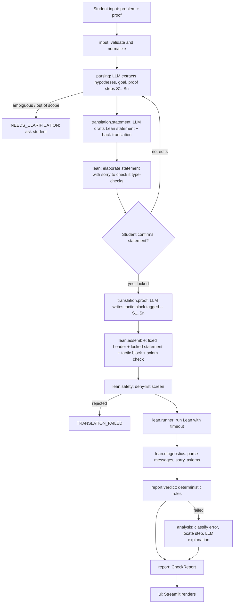

# Architecture

Status: **proposal (Milestone B0)**. Nothing below is implemented yet; each
section names the milestone in [DEVELOPMENT_PLAN.md](DEVELOPMENT_PLAN.md) that
builds it. Requirements: [SPEC_BASIC.md](SPEC_BASIC.md),
[SPEC_ADVANCED.md](SPEC_ADVANCED.md).

## 1. Non-negotiable rules

These come straight from the specs and shape every module:

1. **Lean decides, the LLM never does.** The verdict is computed by Python code
   from Lean's process result and diagnostics. No LLM output can produce or
   upgrade a `VERIFIED` status.
2. **A compiled Lean proof is not a verdict on the student's proof.** The report
   always separates *"Lean accepted the formalized proof"* from *"the
   formalization faithfully reflects what the student wrote"*. The UI never says
   "your proof is correct".
3. **The statement is locked before the proof is translated.** The student sees
   the original statement and the Lean statement side by side and confirms it.
   After that, Python — not the LLM — assembles the final Lean file around the
   confirmed statement, so the translator cannot weaken the theorem to make a
   proof go through.
4. **Ambiguity stops the pipeline.** If the parser reports ambiguity or an
   out-of-scope problem, the app asks the student instead of inventing
   assumptions.
5. **Lean runs in a controlled way.** The LLM never writes imports, commands, or
   shell input. Generated Lean is screened by a deny-list, run with a timeout
   from a temporary directory, with an argument list (never `shell=True`).

## 2. Pipeline



Every LLM step is a **separate, small call with a structured (Pydantic) output
schema**. No step asks the model for one large unstructured answer.

## 3. Verdict rules (deterministic)

| Status | Condition |
| --- | --- |
| `VERIFIED` | Lean exited normally within the timeout **and** there are no `error` diagnostics **and** no `sorry` warning **and** `#print axioms` reports only `propext`, `Classical.choice`, `Quot.sound` **and** the compiled theorem statement is byte-identical to the student-confirmed one. |
| `VERIFICATION_FAILED` | Lean ran to completion and reported an error, an unsolved goal, or a non-standard axiom. |
| `TRANSLATION_FAILED` | The LLM output was invalid, refused, incomplete (a step it could not formalize is left as an explicit placeholder), or rejected by the safety screen. |
| `NEEDS_CLARIFICATION` | The parser found ambiguity, or the problem is outside the supported topics. |
| `RUNTIME_ERROR` | Lean is missing, crashed or timed out, or the LLM API call failed. |

Alongside the status, every report carries a **fidelity summary** that is never
folded into the status:

* whether the student confirmed the formal statement;
* proof steps that were translated as written, **added** by the translator,
  **omitted**, or **changed** (computed from the `-- [Sk]` step tags, see §6);
* translator notes.

Headline wording follows both: e.g. *"Lean accepted the formalized proof. The
translator added 2 steps that are not in your proof — see the mapping."*

## 4. Modules

Python package `src/ra_checker/`. One responsibility per module; the UI holds no
business logic; every external dependency (LLM, Lean) sits behind a small
interface with a fake for tests.

| Module | Responsibility | Spec component | Milestone |
| --- | --- | --- | --- |
| `config.py` | Settings from environment / `.env` (API key, model, Lean path, timeouts). | infrastructure | B1 |
| `models.py` | Pydantic data models shared by all modules (see §5). | infrastructure | B1 |
| `logging_setup.py` | Standard-library logging; never logs keys; logs IDs and statuses, not full student text, by default. | infrastructure | B1 |
| `input_validation.py` | Length limits and empty-input checks; NFC-normalized copy for the LLM (the stored submission stays verbatim). | input processing | B4 |
| `llm/client.py` | `LLMClient` protocol, `AnthropicClient` (official `anthropic` SDK, structured outputs), `FakeLLMClient` for tests. | LLM communication | B4 |
| `llm/prompts.py` | Versioned prompt templates; the prompt version is recorded in each report. | LLM communication | B4 |
| `parsing/problem_parser.py` | Hypotheses, goal, numbered proof steps, ambiguities, topic/scope check. | problem parsing | B4 |
| `translation/statement.py` | Lean statement + natural-language back-translation + list of any assumptions added. | Lean code generation | B5 |
| `translation/proof.py` | Tactic block only, each block tagged `-- [Sk]`; step map; translator notes. | Lean code generation | B5 |
| `lean/assemble.py` | Builds the `.lean` file: fixed header, locked statement, tactic block, `#print axioms`. Records line offsets. | Lean execution | B2 |
| `lean/safety.py` | Deny-list screen of generated Lean (§7). | Lean execution | B2 |
| `lean/runner.py` | `LeanRunner` protocol; subprocess runner with timeout and process-tree kill; `FakeLeanRunner`. | Lean execution | B2 |
| `lean/diagnostics.py` | Parses Lean output into `Diagnostic` objects; detects `sorry` and axioms. | Lean execution | B2 |
| `analysis/classify.py` | Rule-based Lean error kind from the message text. | error analysis | B5 |
| `analysis/locate.py` | Maps a diagnostic line to the enclosing `-- [Sk]` tag and the student's step text. | error analysis | B6 |
| `analysis/explain.py` | LLM explanation with category, origin, confidence, correction direction (§8). | error analysis | B6 |
| `report/verdict.py` | The deterministic verdict rules of §3. | Lean verification | B2 |
| `report/presentation.py` | Deterministic student-facing wording: headlines, category/origin labels, "cannot confidently identify". | result presentation | B7 |
| `pipeline.py` | `Checker`: `formalize` (phase 1) → `PendingCheck` → student confirms → `verify` (phase 2) → `CheckReport`. | orchestration | B7 |
| `ui/app.py`, `ui/components.py`, `ui/services.py` | Streamlit flow, rendering only, and construction of the real checker (or a list of what is missing). | user interface | B7 |
| `explain/code_explainer.py` | Per-block code explanation grounded in the actual code and verdict. | code explanation | A2 |
| `report/mapping.py` | Original-step ↔ Lean-block table with added/omitted/changed flags, built from the code's tags. | proof mapping | A3 |
| `analysis/correction.py` | Proposes corrected code, **re-runs it through Lean**, labels it verified only if §3 passes. | enhanced errors | A4 |
| `learning/cards.py`, `learning/detect.py` | Hand-written, Lean-checked concept cards (intro, rw, …) selected by the tactics found in the checked code, with where each occurs. | learning content | A5 |
| `learning/practice.py` | Practice answers checked by the real Lean runner through the same verdict rules. | learning content | A5 |

## 5. Core data models (implemented in B1)

`src/ra_checker/models.py`. All models are frozen Pydantic models with tuple
collections and `extra="forbid"`; student text is stored verbatim.

* `Submission` — `problem_text`, `proof_text`, `mode` (`quick` / `learning`).
* `ProblemAnalysis` — `hypotheses`, `goal`, `proof_steps` (`ProofStep`: `id`
  `S1…`, `text`, `verbatim` — false if the parser reworded the student),
  `ambiguities`, `in_scope`, `out_of_scope_reason`, `topic`;
  `needs_clarification`.
* `FormalStatement` — `lean_statement`, `back_translation`,
  `assumptions_added`, `confirmed_by_student`.
* `ProofTranslation` — `tactic_block`, `step_map` (`StepMapping`: `step_id`,
  `status` `translated` / `added` / `omitted` / `changed`, `note`),
  `translator_notes`. Student steps use ids `S1, S2, …`; steps the translator
  adds use `A1, A2, …` and must have status `added`.
* `FidelitySummary` — `statement_confirmed` and the step ids per status;
  `from_translation()`; `is_faithful`.
* `LeanRun` — `source` (the exact file Lean checked), `exit_code`,
  `timed_out`, `duration_s`, `stdout`, `stderr`, `lean_version`.
* `Diagnostic` — `line`, `column`, `severity`, `message`, `goal_state`,
  `step_id`.
* `ErrorAnalysis` — `lean_error_kind`, `category` (the spec categories, with
  missing assumption and incomplete proof kept separate, plus
  `formalization_error` and `unknown`), `origin`, `confidence`, `raw_message`,
  `explanation`, `step_id`, `line`, `correction_direction`.
* `CheckReport` — `id`, `created_at` (UTC), `submission`, `status`,
  `status_detail`, all stage outputs above, `llm_model`, `prompt_version`.

`CheckReport` validates its status on construction and on deserialization:
`VERIFIED` needs a completed Lean run with exit code 0, no error diagnostics,
no error analyses, a student-confirmed statement that appears in the checked
source, a proof translation and a fidelity summary; `VERIFICATION_FAILED` needs
the Lean run; `NEEDS_CLARIFICATION` needs an ambiguous or out-of-scope
analysis; every non-verified status needs a `status_detail`. This is a last
line of defence; §3's full rules live in `report/verdict.py`.

Settings (`config.py`) and logging (`logging_setup.py`) are described in the
README's Configuration section.

## 6. Lean layer

**Project.** A Lake project in `lean/` with `lean-toolchain` and the Mathlib
dependency pinned to one release (chosen at B2). Mathlib build artefacts come
from `lake exe cache get`; `lean/.lake/` is git-ignored.

**Student-friendly definitions** (implemented in B3). Students write ε–N
proofs; Mathlib states limits with filters (`Tendsto u atTop (𝓝 L)`).
Translating ε–N reasoning directly into filter language would make the proof
mapping unfaithful. So `lean/RaChecker/Defs.lean` defines the textbook notions
in namespace `RaChecker`, for example

```lean
def SeqConvergesTo (a : ℕ → ℝ) (L : ℝ) : Prop :=
  ∀ ε > 0, ∃ N : ℕ, ∀ n ≥ N, |a n - L| < ε
```

| Definition | Bridge lemma (`lean/RaChecker/Bridge.lean`) |
| --- | --- |
| `SeqConvergesTo a L` | `seqConvergesTo_iff_tendsto : … ↔ Tendsto a atTop (𝓝 L)` |
| `SeqConverges a` | `seqConverges_iff : … ↔ ∃ L, Tendsto a atTop (𝓝 L)` |
| `SeqBounded a` | `seqBounded_iff_isBounded_range : … ↔ Bornology.IsBounded (Set.range a)` |
| `SeqCauchy a` | `seqCauchy_iff_cauchySeq : … ↔ CauchySeq a` |
| `SeqTendsToInfinity a` | `seqTendsToInfinity_iff_tendsto : … ↔ Tendsto a atTop atTop` |

The bridge lemmas prove the definitions mean what Mathlib means, and let a
proof move to Mathlib's library when convenient. The translator is instructed
to use these definitions. The library is built with `lake build`; an error in
the assembled file's header (for example an unbuilt library) is classified as
`RUNTIME_ERROR`, never as a proof error. Reference exercises with
Lean-verified formalizations live in `tests/fixtures/reference_cases.toml`.

**Assembled file.** The LLM writes only the tactic block. Python writes
everything else:

```lean
import Mathlib
import RaChecker

open RaChecker
set_option autoImplicit false

theorem student_claim <locked statement> := by
  -- [S1]
  intro ε hε
  -- [S2]
  ...

#print axioms student_claim
```

`autoImplicit false` is essential: with Lean's default, an unknown lower-case
name in the statement silently becomes a new universally quantified variable,
so a mistranslated statement would still type-check (found in B2).

Before the proof is translated, the locked statement is elaborated once with
`:= by sorry` to prove it type-checks (`assemble_statement_check`,
`decide_statement_check`).

**Execution** (`lean/runner.py`). Each check writes the file to a fresh
temporary directory and runs `lake env lean <file>` with the Lean project as
working directory, using an argument list (no shell), closed stdin, an
environment with secret-looking variables (`*KEY*`, `*TOKEN*`, …) removed, a
wall-clock timeout, an output-size cap, and process-tree termination on
timeout (`taskkill /T` on Windows, a process group elsewhere). `lake` is found
on PATH or in `~/.elan/bin`.

**Output format** (Lean 4.36, frozen in `tests/fixtures/lean_output/`): errors
and warnings are `file:line:col: severity[(code)]: text` plus continuation
lines; `#print axioms` prints a bare `'student_claim' depends on axioms: […]`
line; a placeholder produces the warning ``declaration uses `sorry` ``.
`sorryAx` also appears in the axiom list after any error, as Lean's error
recovery, so it is not taken to mean "placeholder" (it still blocks
`VERIFIED`, being non-standard).

**Latency.** Measured in B2: about 23 s per check with `import Mathlib`,
almost all of it the import (12–15 s with narrower imports). The full import is
kept for now; a persistent Lean process (A8) removes the import cost.

## 7. Safety model

Lean can run arbitrary code at compile time (`#eval`, `run_cmd`, custom
`elab`/`macro`, `IO`), so the generated text is screened before Lean sees it:

* The LLM never supplies imports, `open` commands, options, or top-level
  commands — only a tactic block (and, earlier, a statement).
* Deny-list (`lean/safety.py`; token-level, comments skipped first): every
  `#` command; command and declaration keywords (`import`, `set_option`,
  `def`, `theorem`, `axiom`, `namespace`, `end`, …) — needed because a tactic
  block can start a new top-level command at any indentation; metaprogramming
  (`run_tac`, `run_cmd`, `elab`, `macro`, `syntax`, `notation`, …);
  `unsafe`, `implemented_by`, `extern`, `native_decide`, `admit`; the `IO`,
  `Lean` and `System` namespaces; attributes `@[…]`; `«guillemet»`
  identifiers; string literals; control and bidirectional-override
  characters; unterminated block comments; a maximum length. Statements
  additionally may not contain `:=` or `sorry`.
* `sorry` is allowed only as an explicit "could not formalize this step"
  placeholder; it always prevents `VERIFIED`.
* `#print axioms` catches anything that slips past (e.g. `native_decide`
  introduces `Lean.ofReduceBool`).
* Lean runs with a timeout from a temp directory; Python never invokes a shell.

Residual risk: a deny-list is not a sandbox. Running Lean inside a no-network
Docker container is an optional hardening milestone (Docker is available on the
development machine).

## 8. Error analysis

1. **Classify (rules, B6).** Pattern-match Lean's message into a
   `lean_error_kind`: `syntax`, `unknown_identifier`, `type_mismatch`,
   `unsolved_goals`, `tactic_failed` (e.g. `linarith failed`), `other`.
2. **Locate (rules, B6).** Map the diagnostic line to the nearest preceding
   `-- [Sk]` tag, giving the student's step text and the Lean snippet.
3. **Explain (LLM, B6).** A structured call receives the student step, the Lean
   snippet, the error kind, the raw message and goal state, and returns:
   * `category` — one of the seven spec categories (mathematical reasoning,
     missing assumption / incomplete proof, incorrect theorem application,
     algebraic/computational, Lean syntax, type mismatch, unresolved goal), or
     `formalization_error`, or `unknown`;
   * `origin` — `student_reasoning`, `formalization`, or `undetermined`;
   * `confidence` — `high` / `medium` / `low`;
   * `explanation`, `correction_direction`.
4. **Guardrails (code, `analysis/explain.py`).** `syntax` and
   `unknown_identifier` errors are forced to `origin = formalization` and get a
   fixed explanation without an LLM call — they are Lean-side problems, not
   mathematics. Errors inside translator-added `A` steps are formalization
   errors. A self-contradictory answer (student origin, Lean category) becomes
   `undetermined`/`low`; a `formalization` origin cannot carry a student
   category; high-confidence blame on a step the translator `changed` or
   `omitted` drops to `medium`. If the LLM is unavailable the rule-based
   fallback is `undetermined`/`low`. `ErrorAnalysis.confident` is false for
   `low` confidence or `undetermined` origin, and the UI then says *"We cannot
   confidently identify the mathematical error."* The raw Lean message is
   always shown next to the explanation. At most three errors per check are
   analysed.

Errors that Lean reports on the theorem line (notably "unsolved goals" at
`by`, when the proof ends with something left to prove) are attributed to the
last step with `at_end_of_proof`, and the open goal is shown to the explainer.

## 9. LLM layer

* Provider: Anthropic Claude via the official `anthropic` Python SDK (1.x).
  Model is configurable (`RA_CHECKER_MODEL`), default `claude-opus-5-5`.
* Every call is `client.beta.messages.parse(..., output_format=<Pydantic
  model>, output_config={"effort": …})`; the SDK validates the answer
  against the schema. Thinking is left at the model's default (adaptive);
  effort is set per task (`medium` for parsing, higher for translation).
* For models that support it, Claude's server-side refusal fallback is on
  (`betas=["server-side-fallback-2026-07-01"]`, `fallbacks="default"`): if the
  model declines, the API re-runs the request on a fallback model. The model
  that actually answered (`response.model`) is recorded in the report.
* Refusals (`stop_reason == "refusal"`) raise `LLMRefusalError`, truncated or
  off-schema answers `LLMOutputError` (both → `TRANSLATION_FAILED`); every SDK
  error becomes `LLMUnavailableError` (→ `RUNTIME_ERROR`) with a generic
  message — the SDK error is not chained, so neither the key nor response
  bodies leak. The SDK's built-in retries (2) handle transient failures; the
  timeout is `RA_LLM_TIMEOUT_S`.
* Student text is wrapped in `<problem>` / `<student_proof>` tags, any closing
  tag inside it is neutralized, and the system prompt tells the model to treat
  it as data. Logs record task, model, tokens, duration and request id — never
  the text.
* The API key comes only from `ANTHROPIC_API_KEY` (or a git-ignored `.env`).
* A **formalization repair loop** (B5, at most 2 repairs per stage). For the
  statement, Lean's errors (or safety-screen violations) are sent back and the
  LLM must keep the meaning. For the proof, repair runs only when *every* Lean
  error is a syntax error or an unknown name (`analysis/classify.py`,
  `LEAN_SIDE_KINDS`) — type mismatches and failed tactics can hide a real gap
  in the student's reasoning, so they are reported, never repaired. A repaired
  tactic block is accepted only if it has exactly the same step tags and the
  same number of `sorry` placeholders, so a repair cannot add, drop or fill in
  steps; safety-screen violations are never repaired. The statement is locked
  and inserted by Python, so no repair can touch it. Every attempt is recorded.

## 10. User interface

Streamlit (implemented in B7), two phases held in `st.session_state`; run
with `streamlit run src/ra_checker/ui/app.py`:

1. **Formalize.** Problem + proof inputs → original problem and Lean
   statement side by side with the back-translation and any assumed
   conventions, plus "how we read your proof" (steps, with reworded ones
   flagged) → *Yes, it matches* or *No — I'll clarify*. Clarification
   questions and out-of-scope notices appear here. Nothing is sent to Lean for
   the proof until the student confirms.
2. **Verify.** Headline from `report/presentation.py`, original problem, the
   student's proof, formal statement, generated Lean code (with line numbers),
   verification result, one card per analysed error (location, the student's
   step, classification and origin, explanation or "cannot confidently
   identify", a suggested direction labelled "not checked by Lean", the raw
   Lean message), the step-mapping table, and technical details (models,
   prompt versions, attempts).

**Modes (A1).** *Quick Check* shows the headline, a one-line Lean result and
the error cards; the problem and proof, the formal statement with the Lean
code, and the step table sit in collapsed sections, so no Basic-version field
is removed. *Learning Mode* shows all of it expanded plus the reasoning ↔ Lean
mapping (A3, `report/mapping.py`): each student step next to the tactics
tagged with it in the checked code, built from the tags only and flagged as
approximate when the translation departs from most steps. The toggle only
changes the view; switching never re-runs a check.

If the API key, Lean or Mathlib is missing, the app lists what is missing and
disables checking. Tests inject a `Checker` built from fakes through session
state and drive the app with `streamlit.testing.v1.AppTest`.

Advanced (A1+): a *Quick Check / Learning* toggle. Learning mode adds tabs for
code explanation, proof mapping, and "Learn Lean" cards with practice, and shows
hints before a full correction.

## 11. Testing strategy

* **Unit tests** (default `pytest`): pure Python with `FakeLLMClient` and
  `FakeLeanRunner` — models, safety screen, file assembly, diagnostics parser
  (fixtures captured from real Lean output), classifier, locator, verdict rules,
  pipeline state machine. These must never need network or Lean.
* **Lean integration tests** (`-m lean`): real Lean on hand-written good and bad
  snippets, no LLM. Skipped automatically when Lean is not installed.
* **Live LLM tests** (`-m llm`): opt-in, cost money, never run by default.
* **UI tests**: `streamlit.testing.v1.AppTest` with fakes.
* **Evaluation set** (A7): `eval/cases/*.yaml` covering correct, incorrect,
  incomplete, missing-assumption, hard-to-formalize, and mistranslation cases,
  plus a harness that reports compile rate, statement accuracy, localization
  accuracy, and a human-graded rubric for explanation quality.

## 12. Target layout

```text
real-analysis-checker/
├── README.md
├── AGENTS.md
├── pyproject.toml
├── .env.example
├── docs/            SPEC_BASIC, SPEC_ADVANCED, ARCHITECTURE, DEVELOPMENT_PLAN
├── src/ra_checker/
│   ├── config.py  models.py  logging_setup.py  pipeline.py
│   ├── input/  llm/  parsing/  translation/  lean/  analysis/  report/  ui/
│   └── explain/  learning/                      (advanced)
├── lean/            Lake project: lean-toolchain, lakefile, RaChecker/Defs.lean
├── tests/           unit/, lean/, llm/, fixtures/
└── eval/            cases/, run_eval.py, RUBRIC.md   (advanced)
```
